[DCCP_Presentation.pptx](https://github.com/user-attachments/files/34516281/DCCP_Presentation.pptx)
# DCCP: Datagram Congestion Control Protocol

Course presentation on the **Datagram Congestion Control Protocol (DCCP)**.

- **Presented by:** Rathul Hasan Saion (ID: IT24037)
- **Supervised by:** Dr. Nazrul Islam, Associate Professor, Department of ICT, MBSTU
- **University:** Mawlana Bhashani Science and Technology University (MBSTU), Tangail, Bangladesh

## Download
[Uploading images…]()
[README.md](https://github.com/user-attachments/files/34516284/README.md)

- [Slides (PPTX)](DCCP_Presentation.pptx)
- [Slides (PDF)](DCCP_Presentation.pdf)

## Slides

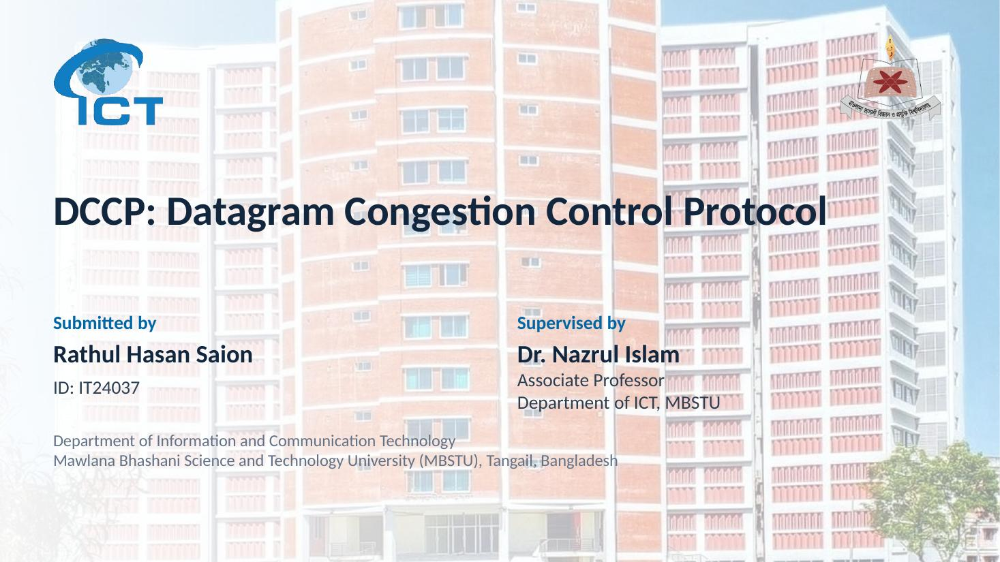
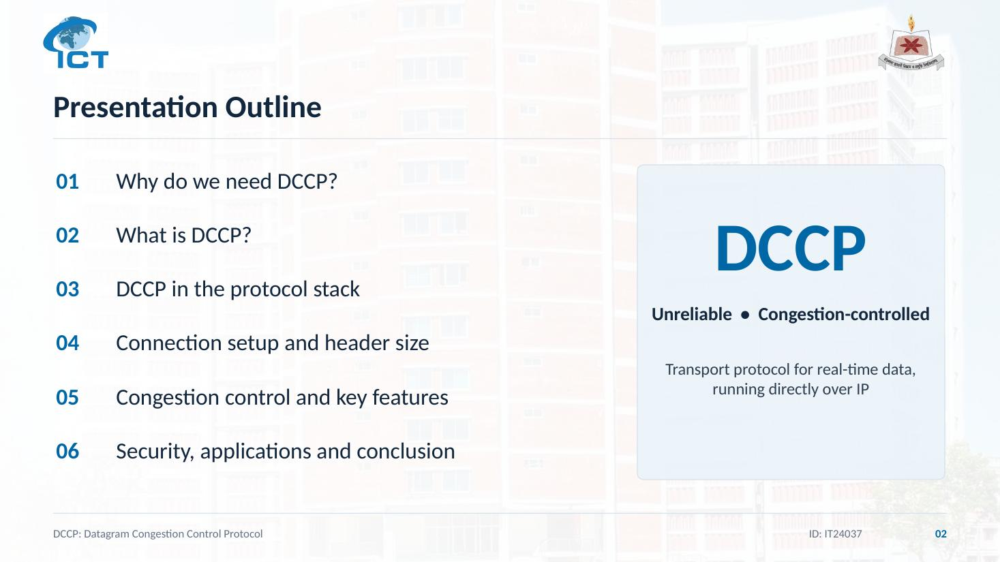
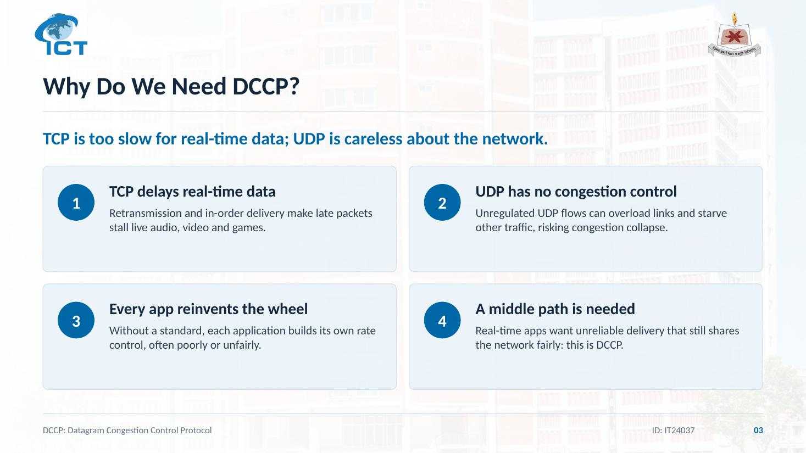
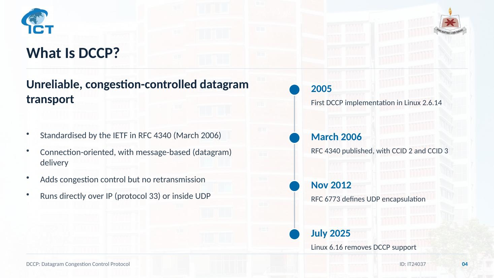
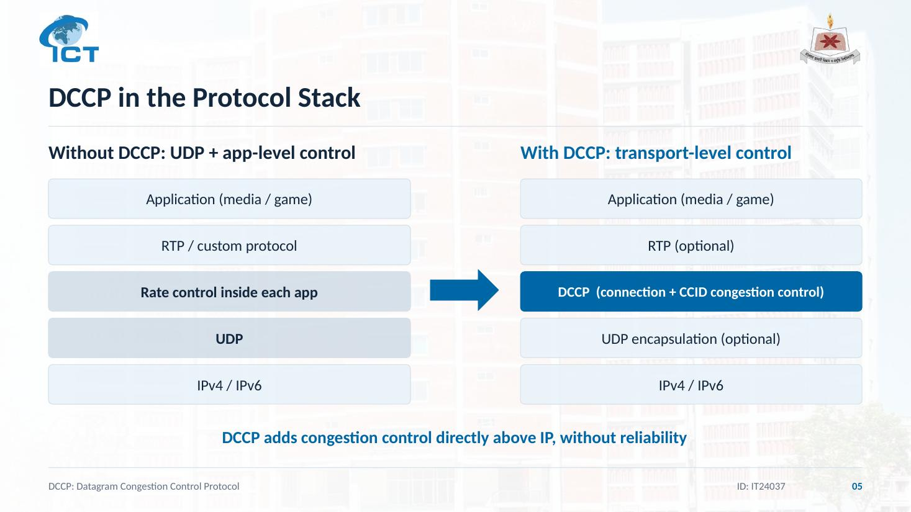
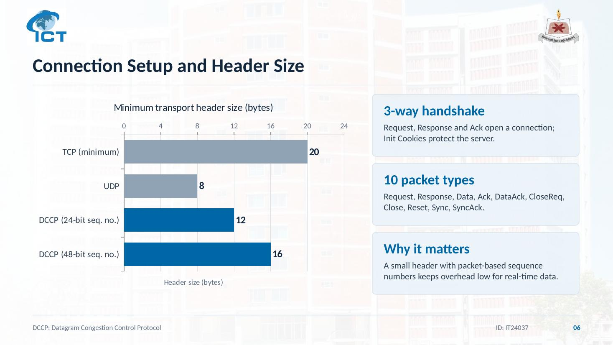
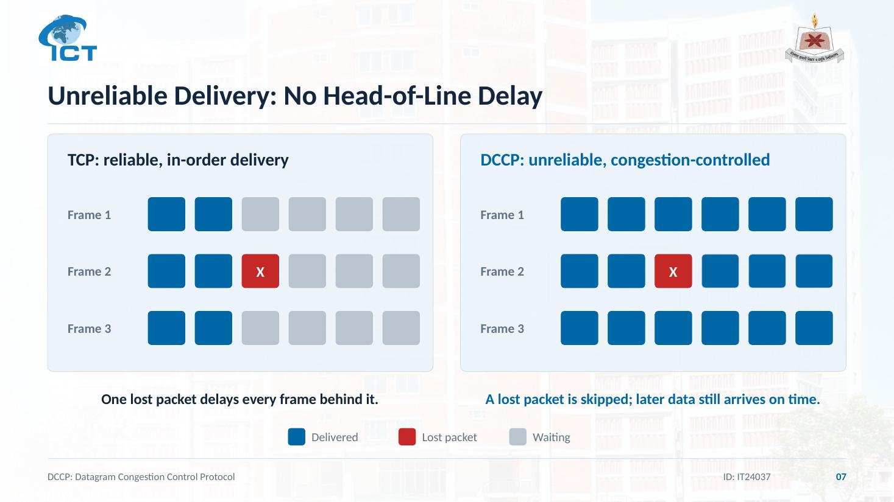
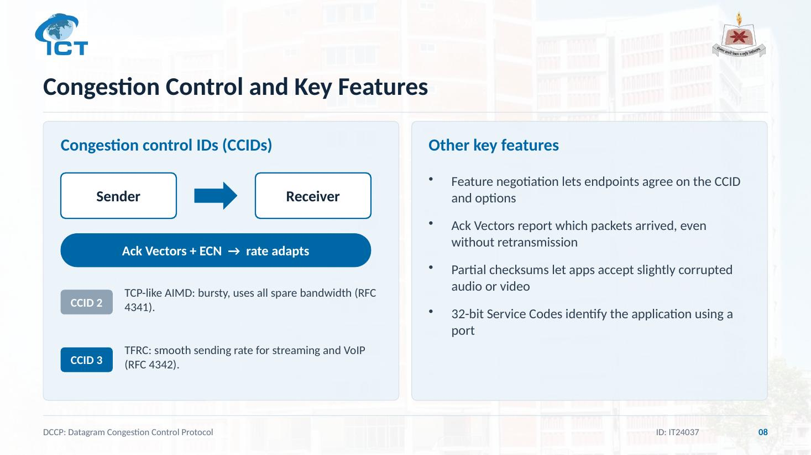
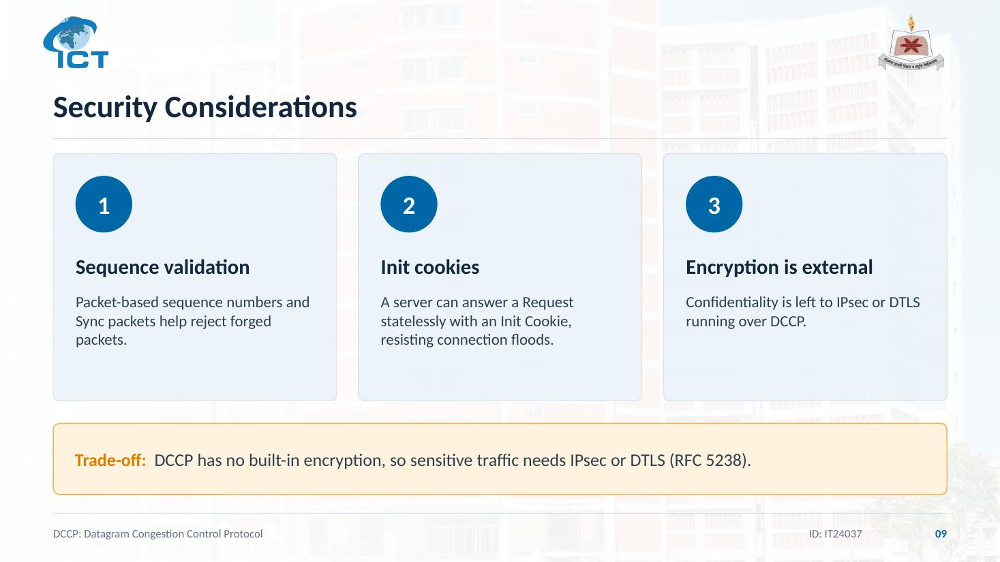
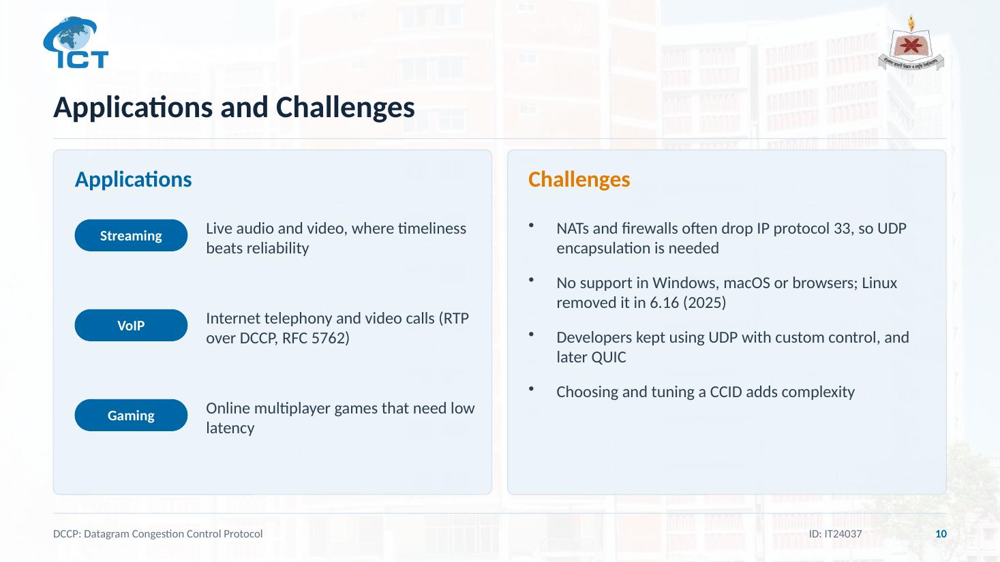
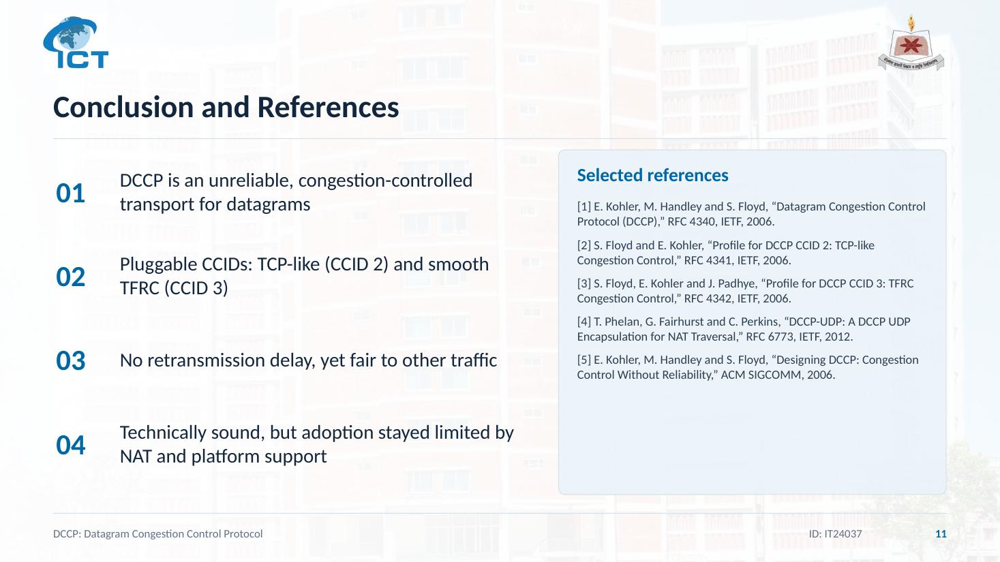
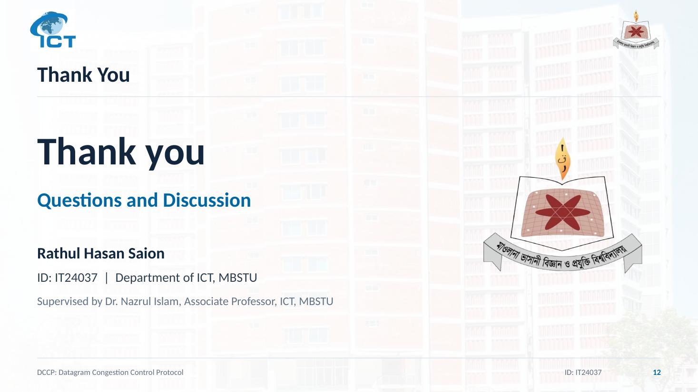

## References

1. E. Kohler, M. Handley and S. Floyd, "Datagram Congestion Control Protocol (DCCP)," RFC 4340, IETF, 2006.
2. S. Floyd and E. Kohler, "Profile for DCCP CCID 2: TCP-like Congestion Control," RFC 4341, IETF, 2006.
3. S. Floyd, E. Kohler and J. Padhye, "Profile for DCCP CCID 3: TFRC Congestion Control," RFC 4342, IETF, 2006.
4. T. Phelan, G. Fairhurst and C. Perkins, "DCCP-UDP: A DCCP UDP Encapsulation for NAT Traversal," RFC 6773, IETF, 2012.
5. E. Kohler, M. Handley and S. Floyd, "Designing DCCP: Congestion Control Without Reliability," ACM SIGCOMM, 2006.
